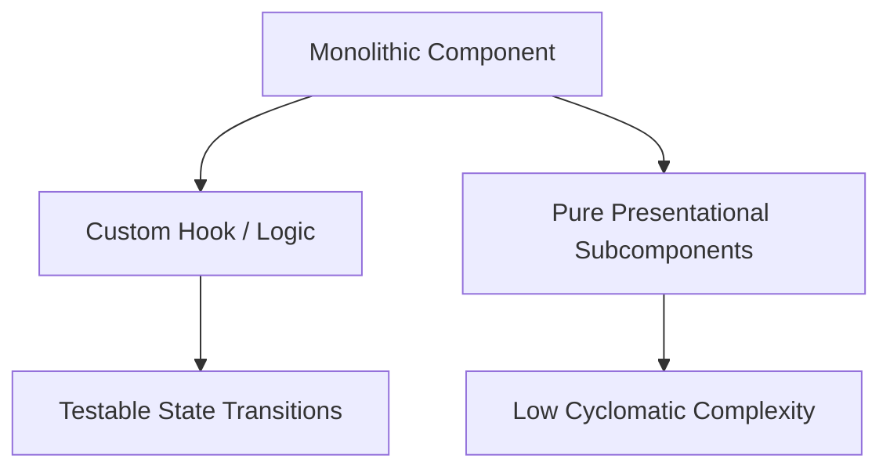

# Design: UI Maintainability Refactoring

## Architecture Overview

The refactoring applies clean architecture and container-presentational decomposition to 7 target components in `apps/mobile`:

## Technical Strategies

### 1. `src/app/(tabs)/explore.tsx`

- **Issue**: Duplicated JSX subtree in banner area.
- **Solution**: Extract `<ExploreBanner />` component. Keep `explore.tsx` focused on data feeding and category rendering.

### 2. `src/components/track-detail-view.tsx`

- **Issues**:
  - `duplicate-jsx-subtree`: `{Platform.OS === 'web' ? <TwView className="flex-1">{innerView}</TwView> : innerView}`
  - `no-high-complexity-react-function`: Large component with multiple conditional blocks (audio states, geofence, feedback, coupons, credits).
- **Solution**:
  - Unify root wrapper: `<TwView className="flex-1">{innerView}</TwView>`.
  - Extract sections to presentational subcomponents:
    - `<TrackHeroHeader />` (cover, title, duration, author)
    - `<TrackActionControls />` (play, download, share)
    - `<TrackGeofenceAlert />` (bottom modal alert)

### 3. `src/components/trip-detail-view.tsx`

- **Issue**: `no-high-complexity-react-function` on main component.
- **Solution**: Extract subcomponents for trip header, audio playback triggers, track list rows, and modal dialogs.

### 4. `src/components/audio-media-controls.tsx`

- **Issue**: `no-high-complexity-react-function` (speed cycling, progress tracking, play/pause conditionals).
- **Solution**:
  - Extract `usePlaybackRate(rate, onRateChange)` or split speed selector button into `<PlaybackSpeedButton />`.
  - Split secondary control buttons into separate subcomponents.

### 5. `src/components/feedback-form.tsx`

- **Issue**: `no-high-complexity-react-function` (rating, feedback text, submission states, keyboard handling, dismiss logic).
- **Solution**:
  - Extract `useFeedbackFormState(status, errorMsg, onSubmit, onDismiss)` to handle state transitions.
  - Keep `FeedbackForm` purely presentational over the form inputs and buttons.

### 6. `src/components/global-audio-player.tsx`

- **Issue**: `no-high-complexity-react-function` (route check, expand/collapse, audio status subscription, gesture/tap handlers).
- **Solution**:
  - Extract `useGlobalPlayerVisibility()` to evaluate whether player should be rendered based on active route and player status.
  - Split mini player bar layout into `<MiniPlayerBar />`.

### 7. `src/components/screen-wrapper.tsx`

- **Issue**: `no-high-complexity-react-function` (conditional padding, safe area insets, background styles, navigation bar spacers).
- **Solution**: Extract style computation into a clean pure helper `getScreenWrapperLayout(props, insets)`.
